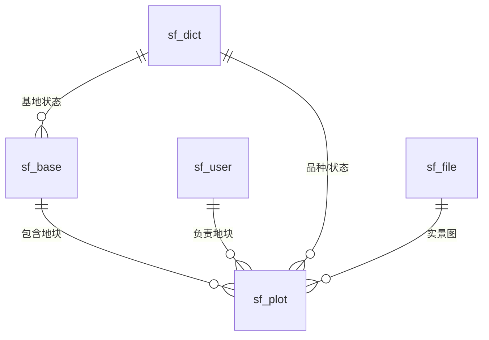
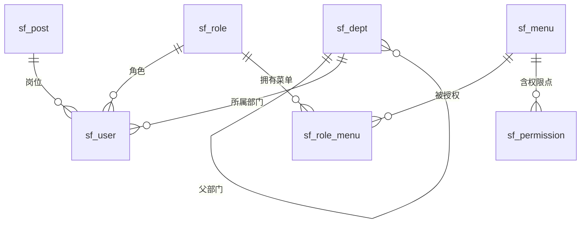

# 智慧果园平台 · 核心数据模型（ER 图与表结构）

> 本文档是《数据设计约定》的落地产物，定义了系统的**地基表**结构。
> 所有后续业务模块（生产/农资/设备/认养/商城/溯源等）的表，都必须参照本文档的标准（命名、公共字段、关联方式）来设计。

---

## 〇、分组总览

| 分组 | 表 | 说明 |
|---|---|---|
| 业务地基 | `sf_base`、`sf_plot`、`sf_dict`、`sf_file`、`sf_operation_log` | 基地、地块、字典、文件、日志 |
| 组织与权限 | `sf_user`、`sf_role`、`sf_dept`、`sf_post`、`sf_menu`、`sf_role_menu`、`sf_permission` | 用户、角色、部门、岗位、菜单、权限 |

---

## 一、业务地基组

### 关联关系（mermaid ER）

### 表结构

**sf_base（基地）**

| 字段 | 类型 | 约束 | 说明 |
|---|---|---|---|
| id | bigint | PK 自增 | 主键 |
| code | varchar(50) | | 基地编号 |
| name | varchar(100) | UK | 基地名称（唯一） |
| base_status | varchar(20) | | 状态（枚举→字典：planning/built/active/disabled） |
| address | varchar(255) | | 地址 |
| area | decimal(12,2) | | 面积（亩） |
| manager_id | bigint | | 负责人（→ sf_user.id，逻辑外键） |
| phone | varchar(20) | | 联系电话 |
| created_at | datetime | | 创建时间 |
| updated_at | datetime | | 更新时间 |
| is_deleted | tinyint | | 逻辑删除（0/1） |

**sf_plot（地块）**

| 字段 | 类型 | 约束 | 说明 |
|---|---|---|---|
| id | bigint | PK 自增 | 主键 |
| code | varchar(50) | | 地块编号 |
| name | varchar(100) | UK | 地块名称（唯一） |
| plot_type | varchar(20) | | 地块类型（→ sf_dict） |
| base_id | bigint | | 所属基地（→ sf_base.id） |
| variety_code | varchar(50) | | 果树品种（→ sf_dict，暂不独立成表） |
| manager_id | bigint | | 负责人（→ sf_user.id） |
| area | decimal(12,2) | | 面积（亩） |
| plant_year | varchar(10) | | 种植年份 |
| lng | decimal(10,6) | | 经度 |
| lat | decimal(10,6) | | 纬度 |
| plot_status | varchar(20) | | 状态（枚举→字典：normal/warning/danger/fallow/maintain） |
| audit_status | varchar(20) | | 审核状态（→ sf_dict） |
| draw_time | datetime | | 绘制时间 |
| remark | varchar(500) | | 绘制说明 |
| file_id | bigint | | 实景图（→ sf_file.id） |
| created_at | datetime | | 创建时间 |
| updated_at | datetime | | 更新时间 |
| is_deleted | tinyint | | 逻辑删除（0/1） |

**sf_dict（数据字典）**

| 字段 | 类型 | 约束 | 说明 |
|---|---|---|---|
| id | bigint | PK 自增 | 主键 |
| dict_type | varchar(50) | | 字典类型（如 plot_status、variety） |
| code | varchar(50) | | 编码 |
| label | varchar(100) | | 显示名 |
| sort_order | int | | 排序 |
| is_deleted | tinyint | | 逻辑删除（0/1） |

**sf_file（文件）**

| 字段 | 类型 | 约束 | 说明 |
|---|---|---|---|
| id | bigint | PK 自增 | 主键 |
| file_name | varchar(255) | | 原始文件名 |
| file_type | varchar(20) | | 类型：image/video/document |
| file_size | bigint | | 大小（字节） |
| store_path | varchar(500) | | 实际存储路径 |
| created_at | datetime | | 上传时间 |

**sf_operation_log（操作日志）**

| 字段 | 类型 | 约束 | 说明 |
|---|---|---|---|
| id | bigint | PK 自增 | 主键 |
| user_id | bigint | | 操作人（→ sf_user.id） |
| module | varchar(50) | | 模块 |
| action | varchar(20) | | 动作：新增/修改/删除/导出/登录 |
| target_id | bigint | | 操作对象 ID |
| detail | text | | 详情 |
| ip | varchar(50) | | 来源 IP |
| created_at | datetime | | 时间 |

---

## 二、组织与权限组

### 关联关系（mermaid ER）

### 表结构

**sf_user（用户）**

| 字段 | 类型 | 约束 | 说明 |
|---|---|---|---|
| id | bigint | PK 自增 | 主键 |
| username | varchar(50) | UK | 账号 |
| password | varchar(100) | | 密码哈希（bcrypt） |
| real_name | varchar(50) | | 姓名 |
| phone | varchar(11) | UK | 手机号（唯一） |
| avatar_file_id | bigint | | 头像（→ sf_file.id） |
| dept_id | bigint | | 部门（→ sf_dept.id） |
| post_id | bigint | | 岗位（→ sf_post.id） |
| role_id | bigint | | 角色（→ sf_role.id） |
| base_id | bigint | | 所属基地（→ sf_base.id） |
| user_status | varchar(20) | | 状态：active/disabled |
| last_login_at | datetime | | 最后登录时间 |
| created_at | datetime | | 创建时间 |
| updated_at | datetime | | 更新时间 |
| is_deleted | tinyint | | 逻辑删除（0/1） |

**sf_role（角色）**

| 字段 | 类型 | 约束 | 说明 |
|---|---|---|---|
| id | bigint | PK 自增 | 主键 |
| role_name | varchar(50) | | 角色名称 |
| role_code | varchar(50) | UK | 角色代码 |
| description | varchar(255) | | 描述 |
| role_status | varchar(20) | | 状态 |
| created_at | datetime | | 创建时间 |
| is_deleted | tinyint | | 逻辑删除（0/1） |

> 初始角色（8 个）：超级管理员、企业管理员、基地管理员、农事操作员、仓库管理员、设备管理员、营销专员、财务管理员。

**sf_dept（部门，树形）**

| 字段 | 类型 | 约束 | 说明 |
|---|---|---|---|
| id | bigint | PK 自增 | 主键 |
| parent_id | bigint | | 父部门（自关联，顶级为 0） |
| dept_name | varchar(100) | | 部门名称 |
| sort_order | int | | 排序 |
| manager | varchar(50) | | 负责人 |
| phone | varchar(20) | | 联系电话 |
| email | varchar(100) | | 邮箱 |
| dept_status | varchar(20) | | 状态：active/disabled |
| created_at | datetime | | 创建时间 |
| is_deleted | tinyint | | 逻辑删除（0/1） |

**sf_post（岗位）**

| 字段 | 类型 | 约束 | 说明 |
|---|---|---|---|
| id | bigint | PK 自增 | 主键 |
| post_code | varchar(50) | UK | 岗位编码 |
| post_name | varchar(100) | | 岗位名称 |
| sort_order | int | | 岗位顺序 |
| post_status | varchar(20) | | 状态 |
| remark | varchar(255) | | 备注 |
| created_at | datetime | | 创建时间 |
| is_deleted | tinyint | | 逻辑删除（0/1） |

**sf_menu（菜单，树形）**

| 字段 | 类型 | 约束 | 说明 |
|---|---|---|---|
| id | bigint | PK 自增 | 主键 |
| parent_id | bigint | | 父菜单（自关联） |
| menu_name | varchar(100) | | 菜单名称 |
| menu_type | varchar(20) | | 目录/菜单/按钮 |
| perm_code | varchar(100) | | 权限标识 |
| route | varchar(255) | | 路由地址 |
| menu_status | varchar(20) | | 状态 |
| sort_order | int | | 排序 |
| created_at | datetime | | 创建时间 |
| is_deleted | tinyint | | 逻辑删除（0/1） |

**sf_role_menu（角色-菜单，中间表）**

| 字段 | 类型 | 约束 | 说明 |
|---|---|---|---|
| id | bigint | PK 自增 | 主键 |
| role_id | bigint | | 角色 |
| menu_id | bigint | | 菜单 |

**sf_permission（权限点）**

| 字段 | 类型 | 约束 | 说明 |
|---|---|---|---|
| id | bigint | PK 自增 | 主键 |
| menu_id | bigint | | 所属菜单 |
| perm_code | varchar(50) | | 权限点（view/add/edit/delete/export） |
| perm_name | varchar(50) | | 权限名 |

---

## 二·五、系统设置补充表（系统管理三页面）

> 对应「系统设置」「菜单设置」「用户设置」三个页面。其中用户/角色/部门/岗位/字典/菜单/权限/日志均已在上文定义，此处补充两张新表。

**sf_system_config（系统配置 · 数据源）** — 对应「系统设置 · 系统配置 Tab」

| 字段 | 类型 | 约束 | 说明 |
|---|---|---|---|
| id | bigint | PK 自增 | 主键 |
| source_name | varchar(100) | | 数据源名称 |
| source_type | varchar(50) | | 类型（→ sf_dict） |
| protocol | varchar(50) | | 协议（mqtt/http 等） |
| access_url | varchar(255) | | 接入地址 |
| collect_freq | varchar(50) | | 采集频率 |
| config_status | varchar(20) | | 状态：active/disabled |
| created_at | datetime | | 创建时间 |
| updated_at | datetime | | 更新时间 |
| is_deleted | tinyint | | 逻辑删除（0/1） |

**sf_notification（通知设置）** — 对应「用户设置 · 通知设置 Tab」

| 字段 | 类型 | 约束 | 说明 |
|---|---|---|---|
| id | bigint | PK 自增 | 主键 |
| user_id | bigint | | 用户（→ sf_user.id） |
| notice_code | varchar(50) | | 通知项编码 |
| enabled | tinyint | | 是否开启：0=关 1=开 |
| created_at | datetime | | 创建时间 |
| updated_at | datetime | | 更新时间 |

> 通知项（notice_code）7 类：`device_alert`（设备预警）、`farming_alert`（农事预警）、`daily_report`（运营日报）、`weekly_report`（运营周报）、`inbox`（站内消息）、`email`（邮件）、`sms`（短信）。唯一约束：`(user_id, notice_code)`。

---

## 二·六、企业信息模块（企业管理 · 企业信息页）

> 对应 `enterprise_info.html`，8 个区块。其中「基本信息」为单行表，其余为「一对多」子表，均以 `enterprise_id` 关联主表。

**sf_enterprise（企业基本信息，单行）**

| 字段 | 类型 | 约束 | 说明 |
|---|---|---|---|
| id | bigint | PK 自增 | 主键 |
| name | varchar(200) | | 企业名称 |
| credit_code | varchar(50) | | 统一信用代码 |
| legal_person | varchar(50) | | 法定代表人 |
| capital | decimal(16,2) | | 注册资本（万元） |
| establish_date | date | | 成立日期 |
| enterprise_type | varchar(50) | | 企业类型（→ sf_dict） |
| industry | varchar(100) | | 所属行业 |
| biz_status | varchar(50) | | 经营状态（→ sf_dict） |
| address | varchar(300) | | 注册地址 |
| scope | text | | 经营范围 |
| term_start | date | | 营业期限起 |
| term_end | date | | 营业期限止（长期为空） |
| authority | varchar(100) | | 登记机关 |
| banner_file_id | bigint | | 横幅图（→ sf_file.id） |
| created_at / updated_at / is_deleted | — | | 公共字段 |

> 注意：原型的「营业期限」把起止日期拼成一句话文本（`"2010年10月11日 至 长期"`），已按铁律 3 拆为 `term_start` + `term_end` 两个 date 字段。

**sf_enterprise_biz（业务结构，一对多）**

| 字段 | 说明 |
|---|---|
| id / enterprise_id / sort_order | 主键、关联企业、排序 |
| icon / color | 图标、色值标识 |
| name / description | 业务名称、业务描述 |
| m1_label / m1_value / m2_label / m2_value | 两个指标的名称与数值 |

**sf_enterprise_staff（人员规模，一对多）**

| 字段 | 说明 |
|---|---|
| id / enterprise_id / sort_order | 主键、关联、排序 |
| role_type | 角色分类（→ sf_dict：管理/销售/技术/作业/后勤/其他） |
| count | 人员数量 |

**sf_enterprise_expert（专家团队，一对多）**

| 字段 | 说明 |
|---|---|
| id / enterprise_id / sort_order | 主键、关联、排序 |
| name / avatar_file_id / role / org / join_date / description | 姓名、头像、职务、机构、加入日期、简介 |

**sf_enterprise_cert（资质证书，一对多，跨端共享）**

| 字段 | 说明 |
|---|---|
| id / enterprise_id / sort_order | 主键、关联、排序 |
| cert_type | 资质类型（→ sf_dict） |
| cert_no / org | 证书编号、发证机构 |
| issue_date / expire_date | 发证日期、有效期至 |
| file_id | 证书图片（→ sf_file.id） |
| top_show | 顶部显示：0=否 1=是 |
| cert_status | 状态：active/expired/revoked |

**sf_enterprise_timeline（发展历程，一对多）**

| 字段 | 说明 |
|---|---|
| id / enterprise_id / sort_order | 主键、关联、排序 |
| timeline_date / title / description | 时间、标题、描述 |

**sf_enterprise_operation（经营数据，一对多）**

| 字段 | 说明 |
|---|---|
| id / enterprise_id / sort_order | 主键、关联、排序 |
| label | 经营指标 |
| value | 经营数值（decimal，原型的字符串已结构化） |
| unit | 单位（万元/吨/亩/项/户） |

---

## 二·七、土壤检测 + VR 全景（企业管理其余两页）

> 「企业管理」一级菜单共 5 页：企业信息 / 基地管理 / 地块管理 / 土壤检测 / VR 全景。

**sf_soil_test（土壤检测记录，跨端共享）**

| 字段 | 类型 | 说明 |
|---|---|---|
| id | bigint | PK 自增 |
| test_code | varchar(50) | 检测编号 |
| plot_id | bigint | 地块（→ sf_plot.id） |
| sample_date | date | 采样日期 |
| lab | varchar(100) | 化验室/检测机构 |
| organic_matter | decimal(5,2) | 有机质(%) |
| available_n | decimal(6,2) | 速效氮(mg/kg) |
| available_p | decimal(6,2) | 速效磷(mg/kg) |
| available_k | decimal(6,2) | 速效钾(mg/kg) |
| ph | decimal(4,2) | pH |
| ec | decimal(8,2) | EC(μS/cm) |
| created_at / updated_at / is_deleted | — | 公共字段 |

> 数据源 `smartorchard_soil_tests_v1`，后台 / 大屏 / 移动端同源读取。EC 统一按 μS/cm 存储，展示时换算 mS/cm。

**sf_vr_scene（VR 全景场景）**

| 字段 | 类型 | 说明 |
|---|---|---|
| id | bigint | PK 自增 |
| scene_code | varchar(50) | 场景编码 |
| name | varchar(100) | 场景名称 |
| base_id / plot_id | bigint | 所属基地/地块 |
| scene_type | varchar(20) | 场景类型（entrance/plot 等） |
| scene_status | varchar(20) | 状态：published/draft |
| image_file_id | bigint | 全景图（→ sf_file.id） |
| yaw / pitch / hfov | decimal | 初始视角参数 |
| created_at / is_deleted | — | 公共字段 |

**sf_vr_hotspot（VR 全景热点，一对多）**

| 字段 | 类型 | 说明 |
|---|---|---|
| id | bigint | PK 自增 |
| scene_id | bigint | 所属场景（→ sf_vr_scene.id） |
| hotspot_code | varchar(50) | 热点编码 |
| hotspot_type | varchar(20) | 类型：plot/device/task/building/scene |
| title | varchar(100) | 标题 |
| content | text | 内容（HTML） |
| target_id | varchar(100) | 关联目标 |
| pitch / yaw | decimal | 位置角 |
| hotspot_status | varchar(20) | 状态：normal/warning/danger |
| created_at / is_deleted | — | 公共字段 |

> 数据源 `vr-hotspots.js`：3 个场景、12 个热点、5 类热点类型。

---

## 三、业务域表结构总览（全量建表完成）

> 以下为剩余 14 个一级菜单建表结果，共 **131 张表**（含地基组、组织权限组）。每张表的完整字段定义见 `server/db/schema.sql`（单一数据源，以它为准），本节仅做"页面 → 表"的索引与关键设计说明。

### 生产管理（8 表）
| 页面 | 表 | 关键设计 |
|---|---|---|
| 农事计划 | sf_farming_plan | 计划编号唯一、引用标准、进度 |
| 任务管理 | sf_farming_task | 来源计划、优先级、班组 |
| 农事记录 | sf_farming_record | 关联计划/任务、农事类型枚举 |
| 巡园管理 | sf_patrol_plan + sf_patrol_route + sf_patrol_abnormal | 计划/路线/异常三表 |
| 无人机巡检 | sf_drone_patrol | 架次、航高、RTK、飞行面积 |
| 农事标准 | sf_guide_standard | 标准编号唯一、被引用计数 |

### 采收管理（7 表）
| 页面 | 表 | 关键设计 |
|---|---|---|
| 采收计划 | sf_harvest_plan | 预计/实采量、批次号 |
| 采收记录 | sf_harvest_record | 等级枚举、采收量 kg |
| 采收日报 | —（聚合，无独立表） | 由采收记录汇总 |
| 采后处理 | sf_harvest_process | 处理类型/结果枚举、状态机 |
| 采收发货 | sf_harvest_post | 物流、发货状态机 |
| 储藏管理 | sf_storage_location + sf_storage_env_record | 库位 + 温湿度记录 |

### 物资管理（8 表）
| 页面 | 表 | 关键设计 |
|---|---|---|
| 农资供应商 | sf_material_supplier | 供应商编号唯一 |
| 农资档案 | sf_material_info | 农资编号唯一、安全库存 |
| 农资出入库 | sf_material_io | 单号 IO-YYYYMMDD###、入库/出库 |
| 农资库存 | sf_material_inventory | 可用/锁定/账面、覆盖天数 |
| 领用与使用 | sf_material_usage | 使用台账 + 领用审批 |
| 退库与退货 | sf_material_return | 退库类型 5 类、状态机 |
| 基础配置 | sf_material_warehouse + sf_material_category | 仓库 + 分类（字典层） |

### 溯源管理（9 表）
| 页面 | 表 | 关键设计 |
|---|---|---|
| 批次管理 | sf_trace_batch | 批次号唯一、等级、状态机 |
| 溯源编码 | sf_trace_code | 追溯码唯一、编码规则 GS1/二维码/RFID |
| 溯源查询 | sf_trace_query_log | 查询日志（次数/渠道/地区） |
| 溯源配置 | sf_trace_template + sf_trace_stage | 模板 + 7 固定展示环节 |
| 溯源统计 | —（只读看板，无独立表） | 数据来自查询日志等聚合 |
| 区块链存证 | sf_trace_blockchain | 交易哈希、区块高度 |
| 标签管理 | sf_label_type + sf_label_stock + sf_label_record | 类型/库存/领用三职责分离 |

### 认养管理（8 表）
| 页面 | 表 | 关键设计 |
|---|---|---|
| 认养果树 | sf_adoption_tree | 果树编号唯一、认养状态 |
| 认养农事 | sf_adoption_farming | 农事类型枚举 |
| 认养采收 | sf_adoption_harvest | 预计/实际采收量 |
| 认养订单 | sf_adoption_order | 认养金额、期限、续费 |
| 成长相册 | sf_adoption_photo | 照片存 file_id |
| 认养证书 | sf_adoption_cert + sf_adoption_cert_template | 证书 + 模板 |
| 认养展示配置 | （复用 sf_adoption_tree 果树池） | 果树池 + 展示配置 |

### 预警管理（3 表）
| 页面 | 表 | 关键设计 |
|---|---|---|
| 预警总览 | —（看板，无独立表） | 由 sf_alert_record 聚合 |
| 设备预警 / 农事预警 | sf_alert_record | 统一预警记录，来源 6 类、级别 4 级、状态 6 态 |
| 内部报告 | sf_alert_report | 报告类型 4 类 |
| 预警设置 | sf_alert_rule | 规则编号唯一、结构化阈值、作用范围 4 档 |

### 设备管理（14 表）
| 视图 | 表 | 关键设计 |
|---|---|---|
| 设备列表 | sf_device | 设备编号唯一、21 类类型字典 |
| 类型与物模型 | sf_device_type + sf_device_measure | 类型 + 测点（key 唯一） |
| 资产盘点 | sf_device_asset | 应盘/已盘/盘亏 |
| 接入配置 | sf_device_access | 接入方式、采集频率 |
| 网关与协议 | sf_gateway | 6 种协议、密码脱敏 |
| 视频监控 | sf_video_channel | 取流协议、云台/夜视 |
| 维护工单 | sf_device_maintain | 故障分类、工时/停机/费用 |
| 校准检定 | sf_device_calibration | 结论、有效期、证书编号 |
| 备品备件 | sf_device_spare | 库存/安全库存/已领用 |
| 移动报修 | （复用 sf_device_maintain） | — |
| 水肥一体化 / 远程指令与 OTA | sf_device_command | 指令编号 CMD-YYYYMMDD-NNN |
| 运行统计 | —（聚合，无独立表） | 由台账/日志聚合 |
| 设备日志 | sf_device_log | 级别 4 级、类型 6 类、追踪 ID |
| 操作审计 | sf_device_audit | 变更前后 JSON 对比 |

### 证书管理（2 表）
| 页面 | 表 | 关键设计 |
|---|---|---|
| 证书管理 | sf_cert | 12 类证书、主体两模型、状态机 |
| 农产品合格证 | （复用 sf_cert）+ sf_cert_stamp | 合格证为批次凭证类 + 电子签章 |

### 经营分析（7 表）
| 页面 | 表 | 关键设计 |
|---|---|---|
| 收入构成 | sf_biz_revenue_mix | 收入类型 4 类 |
| 应收周转 | sf_biz_receivable | 账龄区间 4 段 |
| 经营指标 | sf_biz_metric | 指标 + 环比 |
| 成本报表 | sf_cost_item | 成本科目 |
| 利润报表 / 营收报表 / 报表总览 | sf_plot_profit | 地块经营数据（品种/产量/收入/成本/利润） |
| 绩效看板 | sf_performance_result | 完成率/质量/工作量/综合 |
| 绩效详情 | sf_performance_task | 任务明细下钻 |

### 销售管理（9 表）
| 页面 | 表 | 关键设计 |
|---|---|---|
| 销售订单 | sf_sales_order | 订单状态 11 态、收款 |
| 发货与物流 | sf_sales_shipment | 物流、签收 |
| 客户管理 | sf_sales_customer | 客户 360、信用额度、账期 |
| 售后与退款 | sf_sales_aftersale | 售后状态 8 态 |
| 价格与促销 | sf_sales_price_policy + sf_sales_promotion | 政策 + 促销双 Tab |
| 销售目标 | sf_sales_target | 目标/实际双口径达成率 |
| 客户对账单 | sf_sales_statement | 对账状态 3 态 |
| 销售统计 | —（聚合，无独立表） | 半年口径统计 |
| （收款流水） | sf_sales_receipt | 收款单号、方式 |

### 数据运营（5 表）
| 页面 | 表 | 关键设计 |
|---|---|---|
| 数据源接入 | sf_data_source | 类型 4 类、协议、心跳 |
| 数据归集 | sf_data_collection | 来源唯一、合格率 |
| 模型监控 | sf_model_monitor | 调用次数、命中率 |
| 成效记录 | sf_achievement + sf_milestone | 成效项 + 里程碑 |

### 模型管理（6 表）
| 页面 | 表 | 关键设计 |
|---|---|---|
| 模型配置 | sf_model_config + sf_model_threshold | 6 模型开关 + 6 阈值 |
| 物候模型 | sf_phenology_stage | 起止日期 MM-DD |
| 病虫害模型 | sf_pest_risk | 风险指数、等级阈值 |
| 产量模型 | sf_yield_forecast | 预估 vs 上年、偏差率 |
| 生长模型 / 气象模型 / 价格模型 | —（预测展示，读其他表） | 无独立持久化表 |

### 商城管理（16 表）
| 子模块 | 表 | 关键设计 |
|---|---|---|
| 商品管理 | sf_mall_product | 商品编码唯一、在售/下架 |
| 分类与规格 | sf_mall_category + sf_mall_variety | 分类 + 品种双表 |
| 促销活动 | sf_mall_promotion | 展示位置、状态 |
| 优惠券 | sf_mall_coupon | 满减/折扣、发放核销 |
| 首页装修 | sf_mall_banner + sf_mall_quick_entry | 轮播 + 快捷入口 |
| C端订单 | sf_mall_order | 订单状态 |
| 售后与退款 | sf_mall_aftersale | 退款状态 4 态 |
| 发票管理 | sf_mall_invoice | 类型 2 类、状态 3 态 |
| 运费模板 | sf_mall_freight | 首件/续件计费 |
| 会员管理 | sf_mall_member | 等级 3 档、积分、消费 |
| 积分与权益 | sf_mall_level_rule | 等级门槛、积分/抵扣比例 |
| 社区内容 | sf_mall_post | 点赞/评论、审核状态 |
| 消息通知 | sf_mall_notice | 触发场景 5 类 |

### 移动端运营（11 表）
| 子模块 | 表 | 关键设计 |
|---|---|---|
| 作业人员账号 | sf_mb_staff_account | 密码 SHA-256、农技专家标识 |
| 意见反馈审核 | sf_mb_feedback | 来源端、处理结论 |
| 专家咨询回复 | sf_mb_expert_consult | 指派专家 |
| 消息推送 | sf_mb_message | 面向对象 mobile/all |
| 同步队列 | sf_mb_sync_queue | 三态、载荷 |
| 资讯管理 | sf_mb_news | 分类 4 类、置顶、阅读量 |
| AI助手配置 | sf_mb_ai_category + sf_mb_ai_question | 分类 + 热门问题 |
| 识别规则配置 | sf_mb_disease_rule | 关键字匹配、置信度、风险 |
| 设备故障知识库 | sf_mb_fault_kb | 分类 6 类、紧急度 3 档、步骤 |

---

## 四、全局约定（回顾，详见《数据设计约定》）

1. 表名统一 `sf_` 前缀，字段小写+下划线，避 MySQL 关键字；
2. 每张业务表带公共字段：`id`、`created_at`、`updated_at`、`is_deleted`（可选 `sort_order`、`remark`）；
3. **一律不加物理外键约束**，通过页面增删改查灵活组织，仅保留唯一约束；
4. 枚举值进字典表，存 code 显示 label；
5. 引用字段存 ID 不存文字；
6. 权限粒度仅到模块级（查看/新增/编辑/删除/导出），不做按钮级/字段级。

---

## 五、建表进度结论

- **17 个一级菜单已全部建表完成**，`server/db/schema.sql` 共 **131 张表**；
- **131/131 张表公共字段已全部齐备**（`id` / `created_at` / `updated_at` / `is_deleted`），无任何例外；
- 纯报表/看板/预测展示页（采收日报、溯源统计、运行统计、销售统计、生长/气象/价格模型等）**不建独立表**，数据由后端对已有表聚合查询；
- 全局公共表 3 张：`sf_file`（文件）、`sf_dict`（字典）、`sf_operation_log`（操作日志）。
- 后端通过 `server/utils/table-meta.js` 运行时读取 `information_schema` 判断表结构，**新增表无需改后端代码**。

---

## 六、全量表清单（按后台菜单顺序，与 schema.sql 一致）

> 这是 131 张表的**权威顺序索引**，与 `server/db/schema.sql` 完全一致。每张表的完整字段定义以 `schema.sql` 为准。

| # | 菜单 | 表清单 |
|---|---|---|
| 0 | 全局公共表 | `sf_dict` `sf_file` `sf_operation_log` |
| 1 | 企业管理 | `sf_enterprise` `sf_enterprise_biz` `sf_enterprise_staff` `sf_enterprise_expert` `sf_enterprise_cert` `sf_enterprise_timeline` `sf_enterprise_operation` `sf_base` `sf_plot` `sf_soil_test` `sf_vr_scene` `sf_vr_hotspot` |
| 2 | 生产管理 | `sf_farming_plan` `sf_farming_task` `sf_farming_record` `sf_patrol_plan` `sf_patrol_route` `sf_patrol_abnormal` `sf_drone_patrol` `sf_guide_standard` |
| 3 | 采收管理 | `sf_harvest_plan` `sf_harvest_record` `sf_harvest_process` `sf_harvest_post` `sf_storage_location` `sf_storage_env_record` |
| 4 | 物资管理 | `sf_material_supplier` `sf_material_info` `sf_material_io` `sf_material_inventory` `sf_material_usage` `sf_material_return` `sf_material_warehouse` `sf_material_category` |
| 5 | 溯源管理 | `sf_trace_batch` `sf_trace_code` `sf_trace_blockchain` `sf_trace_query_log` `sf_trace_template` `sf_trace_stage` `sf_label_type` `sf_label_stock` `sf_label_record` |
| 6 | 认养管理 | `sf_adoption_tree` `sf_adoption_order` `sf_adoption_farming` `sf_adoption_harvest` `sf_adoption_photo` `sf_adoption_cert` `sf_adoption_cert_template` |
| 7 | 预警管理 | `sf_alert_record` `sf_alert_rule` `sf_alert_report` |
| 8 | 设备管理 | `sf_device` `sf_device_type` `sf_device_measure` `sf_device_asset` `sf_device_access` `sf_gateway` `sf_video_channel` `sf_device_maintain` `sf_device_calibration` `sf_device_spare` `sf_device_command` `sf_device_log` `sf_device_audit` |
| 9 | 证书管理 | `sf_cert` `sf_cert_stamp` |
| 10 | 经营分析 | `sf_biz_revenue_mix` `sf_biz_receivable` `sf_biz_metric` `sf_cost_item` `sf_plot_profit` `sf_performance_result` `sf_performance_task` |
| 11 | 销售管理 | `sf_sales_order` `sf_sales_shipment` `sf_sales_customer` `sf_sales_aftersale` `sf_sales_price_policy` `sf_sales_promotion` `sf_sales_target` `sf_sales_statement` `sf_sales_receipt` |
| 12 | 数据运营 | `sf_data_source` `sf_data_collection` `sf_model_monitor` `sf_achievement` `sf_milestone` |
| 13 | 模型管理 | `sf_model_config` `sf_model_threshold` `sf_phenology_stage` `sf_pest_risk` `sf_yield_forecast` |
| 14 | 商城管理 | `sf_mall_product` `sf_mall_category` `sf_mall_variety` `sf_mall_promotion` `sf_mall_coupon` `sf_mall_banner` `sf_mall_quick_entry` `sf_mall_order` `sf_mall_aftersale` `sf_mall_invoice` `sf_mall_freight` `sf_mall_member` `sf_mall_level_rule` `sf_mall_post` `sf_mall_notice` |
| 15 | 移动端运营 | `sf_mb_staff_account` `sf_mb_feedback` `sf_mb_expert_consult` `sf_mb_message` `sf_mb_sync_queue` `sf_mb_news` `sf_mb_ai_category` `sf_mb_ai_question` `sf_mb_disease_rule` `sf_mb_fault_kb` |
| 16 | 系统管理 | `sf_dept` `sf_post` `sf_role` `sf_user` `sf_menu` `sf_role_menu` `sf_permission` `sf_system_config` `sf_notification` |

> 说明：`系统首页`（home.html）为纯展示页，无独立业务表，故不在清单中。
